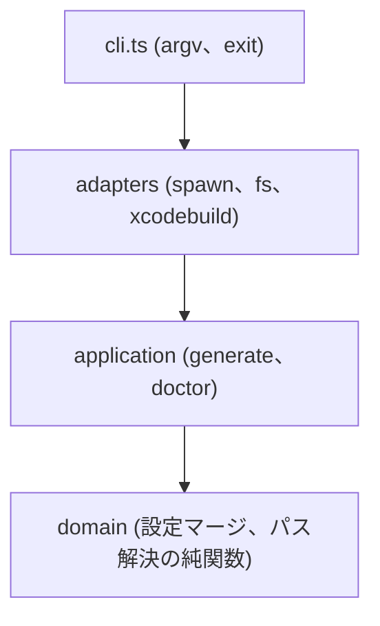

# S2J Acknowledgements - CLI

`s2j-acknowledgements` のサブコマンドと振る舞い契約です。
[S2J Docs Linter の CLI 仕様](https://github.com/stein2nd/docs-linter/blob/main/docs/specifications/cli_tooling_spec.md) に倣い、**再現可能な CLUI** を目指します。

## 起動形

```zsh
npx s2j-acknowledgements <command> [options]
```

ホストでは `devDependency` により bin が PATH に載るため、下記も等価です。

```zsh
s2j-acknowledgements doctor
s2j-acknowledgements generate --config ack.config.json
```

## サブコマンド (v1)

`init` は [S2J Docs Linter](https://github.com/stein2nd/docs-linter) と同型のオンボーディングです。**標準レイアウトはホストルートの `./venv/`** です。

| コマンド | 目的 | v1 |
| --- | --- | --- |
| `doctor` | 前提ツール、Python、推奨バージョンの診断 | **必須** |
| `generate` | パイプライン実行と成果物出力 | **必須** |
| `init` | 設定ひな型、`./venv/` + onot、`.gitignore` 案内 | **必須 (v1)** |
| `help` / `--help` | 使用法 | 必須 |

## ホストルートと設定パス

| 概念 | ルール |
| --- | --- |
| **ホストルート** | `--cwd` があればそれ。なければ `process.cwd()`。`generate` は設定内パスをこのルート基準で解決 |
| **デフォルト設定** | `{ホストルート}/ack.config.json` |
| **環境変数** | `ACK_CONFIG` は `--config` より **優先度が低い** ([config-schema.md](./config-schema.md)) |

`xcode-target-resolution.md` の「`package.json` / `ack.config.json` があるディレクトリ」は、**生成時は `--cwd` と `ack.config.json` の所在**を正とします (`package.json` 単体のリポジトリは `wordpress` 等でも可)。

## `init`

### 目的

ホストプロジェクトに、Acknowledgements 生成に必要な **設定ファイル** と **プロジェクトローカルな onot 実行環境** を用意します。`npm install` だけでは venv は作りません。詳細は [decisions/001-venv-and-init.md](./decisions/001-venv-and-init.md)。

### 必須・任意フラグ

| 引数 | 必須 | 説明 |
| --- | --- | --- |
| `--preset <name>` | **はい** | `macos-app` / `wordpress` / `dir`。省略時 exit `2` |
| `--cwd <path>` | いいえ | ホストルート (デフォルト: `process.cwd()`) |
| `--force` | いいえ | 既存 `ack.config.json` を上書き (設定のみ。venv は対象外) |
| `--write-gitignore` | いいえ | **`.gitignore` がない場合のみ** 最小ファイルを新規作成 (`venv/` と `build/oss-notice/` を含む) |

`init` は `package.json` を変更しません。scripts 追加は [usage.md](./usage.md) を参照してください。

### 作成・更新する成果物

`init` が書き込む `ack.config.json` には、プリセット既定どおり **`tools.venvPath`: `"venv"`** を含めます。

| 成果物 | デフォルト動作 |
| --- | --- |
| `ack.config.json` | 未存在時のみ、`presets/<preset>/defaults.json` をベースに作成。既存時は **スキップ** (WARN、**exit `0`**) 。上書きは `--force` のみ |
| `onot.yaml` | `presets/<preset>/onot.yaml.example`、無ければ `presets/shared/onot.yaml.example` をコピー (未存在時のみ) |
| `./venv/` | 未存在時: `python3 -m venv` → `pip install` で onot + openpyxl をピン留め ([install.md](./install.md))。既存時は **破壊しない** |
| 壊れた venv | `bin/onot` が無効なら **WARN**、`init` は再作成しない。`generate` は exit `1`。修復は将来の `--repair-venv` |

### 冪等性 (`init` 再実行)

CI や手元で **何度でも安全に再実行**できることを v1の前提とします。

| 状態 | `ack.config.json` | `venv/` | exit |
| --- | --- | --- | --- |
| 初回 | 作成 | 作成 | `0` |
| 2回目以降 (通常) | スキップ (WARN) | スキップ | `0` |
| `--force` | 上書き | 変更しない | `0` / 失敗時 `1` |
| `--preset` 未知 | — | — | `2` |
| Python v3.11+ 不在 | — | 作成失敗 | `2` / `1` |

### `.gitignore` 案内と `doctor` 判定

[decisions/001-venv-and-init.md](./decisions/001-venv-and-init.md) に合わせ、**行単位の部分一致** (正規表現は使わない) で判定します。

| チェック | OK とみなす行の例 | WARN |
| --- | --- | --- |
| Ack venv | `venv/`、`venv`、`/venv/` | 該当行なし |
| 中間 SBOM | `build/oss-notice/`、`build/oss-notice` | 該当行なし |

コメント行 (`#`) は無視します。` .venv/` はアプリ用として **Ack venv の OK には含めません** (別 WARN は出さない)。

`init` の案内:

| 状況 | 振る舞い |
| --- | --- |
| **`.gitignore` がない** | 推奨スニペットを表示。`--write-gitignore` で新規作成可 |
| `.gitignore` があるが上記 OK 行がない | WARN、追記候補を表示 (自動追記しない) |
| 両方 OK | 何もしない |

### 終了コード (`init`)

| Code | 意味 |
| --- | --- |
| `0` | 成功 (スキップ・WARN のみ含む) |
| `1` | venv 作成または `pip install` 失敗 |
| `2` | `--preset` 省略・未知、Python 3.11+ 不在 |

## `doctor`

### モード

`--cwd` はホストルートです。フルモードでも config 内パスはホストルート相対です。

| モード | 起動条件 | スコープ |
| --- | --- | --- |
| **基本** | `--config` も `ACK_CONFIG` も無い、または設定ファイルが存在しない | Node、Python、`syft`、onot 解決、`venv`、`.gitignore` (上記判定)。**Feluda はスキップ** |
| **フル** | `--config <path>` または `ACK_CONFIG`、かつファイルが読める | 基本に加え、マージ後設定の `pipeline.feluda` に従い Feluda を必須化 |

### 確認項目 (共通)

| 区分 | チェック |
| --- | --- |
| Node.js | [layout.md](./layout.md) の `engines.node` 準拠 |
| `syft` | PATH、`syft version` ([config/recommended-tools.json](../config/recommended-tools.json) と比較し WARN) |
| onot | **優先**: `{venvPath}/bin/onot`。次点: `tools.onotPath`、PATH 上の `onot` |
| Python | **v3.11+** の `python3` (`init` 未実施時は MISSING 誘導) |
| Ack `venv/` | 存在、`bin/onot` 実行可否、推奨 onot バージョン (WARN) |
| `.gitignore` | [上記表](#gitignore-案内と-doctor-判定) (WARN のみ) |

### 確認項目 (フルモードのみ)

非 macOS では `xcode` 関連チェックは **スキップ** (`wordpress` / `dir` 向け)。

| 区分 | チェック |
| --- | --- |
| `feluda` | `pipeline.feluda: true` のときのみ必須。`false` なら未インストール可 |
| `onot.yaml` | `pipeline.onotConfig` が指すファイルの存在 (無ければ WARN。生成は v1 でも試行する — [pipeline.md](./pipeline.md)) |

### 出力

推奨インストール手順は [install.md](./install.md) への参照を stderr または stdout 末尾に1行載せます。

* 成功時: stdout に表形式または箇条書きで OK / WARN / MISSING
* 終了コード: 必須ツール欠落時は `1`、警告のみは `0`

## `generate`

### 設定パスの解決

`doctor` と同様、`--config` を省略したときは次の順で設定ファイルを決めます。

| 優先 | ソース |
| --- | --- |
| 1 | `--config <path>` |
| 2 | 環境変数 `ACK_CONFIG` |
| 3 | デフォルト `{ホストルート}/ack.config.json` |

ファイルが存在しない場合は exit `2` とし、stderr に `error: config not found: <絶対パス>` を出します。

### 任意引数 (CLI が設定をオーバーライト)

| 引数 | 説明 |
| --- | --- |
| `--config <path>` | 設定ファイル (省略時は上表のデフォルト) |
| `--out <path>` | 最終成果物パス (`output` より優先) |
| `--preset <name>` | 設定の `preset` をオーバーライト |
| `--app <path>` | macOS `.app` 明示 (CI 向け) |
| `--cwd <path>` | ホストプロジェクトルート (デフォルト: `process.cwd()`) |
| `--dry-run` | 解決とコマンド列の表示のみ |
| `--keep-intermediate` | `workDir` を削除しない |
| `--skip-feluda` | 設定にかかわらず Feluda をスキップ |
| `--verbose` | 子プロセスコマンド行を表示 |

### 処理順序

1. 設定ファイル読み込みとスキーマ検証 (失敗時 exit `2`)
2. プリセット適用 (デフォルト値マージ)
3. ターゲット解決 ([xcode-target-resolution.md](./xcode-target-resolution.md))
4. [pipeline.md](./pipeline.md) に従い子プロセス実行 (`onot` は venv 優先で解決)
5. onot が `{workDir}/onot-notice/` に書いた `.md` を `output` / `--out` にコピー ([pipeline.md](./pipeline.md))

### ファイルオーバーライト

`generate` は **最終 Acknowledgements のみ** をオーバーライトします。
`ack.config.json` やホストの `package.json` は変更しません ([S2J Docs Linter](https://github.com/stein2nd/docs-linter) の安全方針と同型)。

## Exit code

| Code | 意味 |
| --- | --- |
| `0` | 成功 |
| `1` | 外部ツール失敗、または `doctor` で必須欠落 |
| `2` | ユーザー入力・設定・ターゲット解決エラー |
| `127` | 実行ファイル未検出 (内部判定) |

### スモークテスト (ACK-001〜006)

CI の `npm run test:doctor` (`scripts/test-doctor.sh`) が再現する最小契約です。

| ID | コマンド | exit | 出力に含む |
| --- | --- | --- | --- |
| ACK-001 | `help` | `0` | `init` |
| ACK-002 | `generate` (ホストルートに `ack.config.json` なし) | `2` | `config not found`、 `ack.config.json` |
| ACK-003 | `init` (`--preset` なし) | `2` | `--preset` |
| ACK-004 | `not-a-command` | `2` | (任意) |
| ACK-005 | `generate` + 不正設定 (`--cwd` サンドボックス) | `2` | `validation failed` |
| ACK-006 | `generate --dry-run` (有効な `ack.config.json`) | `0` | `dry-run` |

## ログ

子プロセスの生ログは `--verbose` 時のみ stdout/stderr に転送します。

| ストリーム | 内容 |
| --- | --- |
| stdout | 人間向け進捗、成功時の出力パス |
| stderr | 警告、子プロセスの要約エラー |

## アーキテクチャー (実装指針)

[S2J Docs Linter](https://github.com/stein2nd/docs-linter) / [Global Composer Setup](https://github.com/stein2nd/global-composer-setup) と同様、**フル Clean Architecture は採用しません**。



副作用 (子プロセス、ファイル I/O) は adapters に閉じ、ユニットテストでは domain を優先します。
