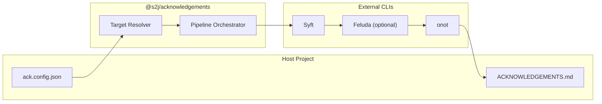

# S2J Acknowledgements - ドメイン

対象ドメイン、責務、非責務を固定します。

## 用語

| 用語 | 定義 |
| --- | --- |
| Third-Party Software | 参考・利用したサードパーティーのソフトウェア (アプリ、ツール、ライブラリ、フレームワーク) |
| SBOM | Software Bill of Materials。本ツールでは主に **SPDX JSON** に正規化する中間表現 |
| Acknowledgements | サードパーティーコンポーネントの名称・バージョン・ライセンス (および必要な場合ライセンス全文) を列挙した文書 |
| Host Project | CLI を `devDependency` で入れ、`ack.config.json` を置くリポジトリ |
| Ack venv | ホストルート直下の **`./venv/`**。`init` が作成し **onot** を入れる Python 仮想環境 (ホストのアプリ開発用 `.venv` とは別) |
| Preset | ホスト種別ごとのデフォルトスキャン方針とパイプラインデフォルト値 |
| Notice (onot 出力) | onot が `{workDir}/onot-notice/` に書く `OSS_Notice_*.md`。CLI が 1 件を選び **加工せず** 最終 `output` にコピー |
| ひな型 | `init` が作る設定・`onot.yaml` のスケルトン (README 等の「スケルトン」と同義) |

### プリセット適用マージ (v1)

1. `presets/<preset>/defaults.json`
2. ホスト `ack.config.json` で上書き
3. **浅いマージ**。ただし次オブジェクトは **深いマージ (1段)**: `pipeline`、`xcode`、`scan`、`syft`、`tools`
4. `scanPaths` 等の配列は **ホストが指定したら丸ごと置換** (要素ごとのマージはしない)

## 責務

本ツール (`@s2j/acknowledgements`) が担うことは、下記に限ります。

1. ホストが指定する **スキャン対象** (ディレクトリ、macOS `.app`、マージ対象など) の解決
2. 外部 CLI (**Syft** → 任意 **Feluda** → **onot**) の順序付き実行
3. 生成された Notice 文書を、ホスト指定の **出力パス** に配置する
4. 前提ツールの有無・バージョンを報告する **`doctor`**
5. 種別ごとの **プリセット** と設定スキーマの提供
6. **`init`**: ホストに `ack.config.json`・`onot.yaml` (任意) のひな型、`./venv/` 上の onot ブートストラップ、`.gitignore` に関する案内

## 非責務

下記は、本ツールの責務に含めません。

| 項目 | 理由 |
| --- | --- |
| 自プロジェクトのアプリケーションライセンス (例: GPL-3.0-or-later) | About の「本アプリのライセンス」とは別表示 |
| `npm install` 時の Syft / Feluda / venv 自動作成 (`postinstall`) | 権限、再現性、CI で壊れやすい。onot は **`init` 明示時のみ** `./venv/` を作成 |
| Syft / Feluda のインストール自動化 (v1) | エコシステムが異なり、ホストは [install.md](./install.md) と `doctor` に従う |
| 既存 `.gitignore` の黙示的マージ | `init` は **案内** または `--write-gitignore` による明示作成のみ。既存ファイルの追記はホスト判断 |
| onot の言語間フルポート | ラッパーで目的を達成。将来 TS サブセット実装は別 initiative |
| Windows 向けターゲット解決 (v1) | スコープ外。パイプライン自体は将来、拡張可能 |
| SPDX / CycloneDX の長期保管を Git に強制 | 中間 SBOM は `workDir` + `.gitignore` 推奨 |
| 法的コンプライアンスの保証 | 生成物は **開発者の入力と上流ツールの出力** に依存する |

## ドメインモデル (概念)

## パイプライン上の「コンポーネント」

SBOM に記録されるエントリーは、実行時依存に限りません。

| 種別 | 例 | プリセットでの扱い |
| --- | --- | --- |
| 実行時依存 | アプリに同梱されるフレームワーク | `macos-app` の `.app` スキャン + SPM マージ |
| ビルド時依存 | Swift Package checkouts | Cozy Brew 向け **マージ SBOM** |
| 開発専用 | `node_modules` (プラグイン開発) | `wordpress` では **デフォルト除外**。同梱する場合のみ `scanPaths` で明示 |
| グローバルツール | 手元の `syft` 自体 | 通常はスキャン対象外 (ホストが明示した場合のみ) |

## 成果物形式 (v1)

| 形式 | v1 | 備考 |
| --- | --- | --- |
| Markdown | **対象** | Cozy Brew About、WP 配布 zip に同梱しやすい |
| HTML | 将来 | onot `-f html` に委譲可能 |
| PDF | 非対象 | v1では扱わない |

## 設定と著作権表示 (onot)

onot 用の共有 YAML (著作権者名、連絡先、年など) は、**ホストのプロジェクト情報** を反映します。
Acknowledgements 本文に載るのは **サードパーティー** の情報が主であり、YAML はテンプレートのメタデータです。

詳細は [config-schema.md](./config-schema.md) を正本とします。
