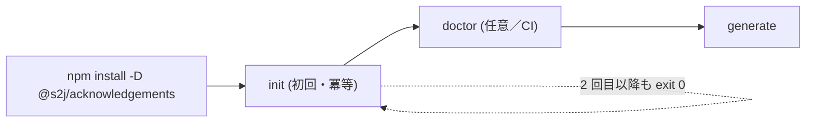

# S2J Acknowledgements - 使い方

ホストプロジェクトから本ツールを呼び出す手順の草案です。

## コマンドの関係



* **初回ローカル**: `npm install` → `init --preset …` → Syft 導入 → `doctor` → `generate`
* **CI**: `npm ci` → `setup-python` → **冪等 `init`** (または venv キャッシュ) → `doctor --config ack.config.json` → `generate`

## 導入

### 1. npm

```zsh
npm install -D @s2j/acknowledgements
```

### 2. `init` (設定 + `./venv/` + onot)

```zsh
s2j-acknowledgements init --preset macos-app
# または: --preset wordpress / dir
```

[cli.md](./cli.md) に従い、`ack.config.json`・任意で `onot.yaml`・**`./venv/`** を用意します。
`.gitignore` がない場合は **`venv/` と `build/oss-notice/` を含めるよう案内** されます。ファイルを自動生成する場合:

```zsh
s2j-acknowledgements init --preset macos-app --write-gitignore
```

### 3. Syft (ホスト手動)

[install.md](./install.md) に従い Syft を入れます (`brew install syft` 等)。`init` ではインストールしません。

### 4. 診断

```zsh
s2j-acknowledgements doctor --config ack.config.json
```

### 5. `package.json` scripts

```json
{
  "scripts": {
    "ack:doctor": "s2j-acknowledgements doctor --config ack.config.json",
    "ack:generate": "s2j-acknowledgements generate --config ack.config.json"
  }
}
```

命名はホスト規約に合わせて `generate:acknowledgements` でもかまいません。

## 典型的なワークフロー

### macOS アプリ (Cozy Brew)

ビルド前に generate すると `.app` 未解決になる場合があります。[xcode-target-resolution.md](./xcode-target-resolution.md) を参照してください。

1. Xcode で **Release** ビルド (または CI でビルド)
2. `npm run ack:generate`
3. 生成された `ACKNOWLEDGEMENTS.md` をアプリバンドル/リポジトリにコミット
4. About 画面は **同梱 MD を表示** (ランタイムで onot を呼ばない)

### WordPress プラグイン

1. `composer install` / ビルド後、プラグインルートで `npm run ack:generate`
2. `ACKNOWLEDGEMENTS.md` を配布物に含める
3. 設定画面や README からリンク (任意)

### 汎用ディレクトリ

`preset: dir` と `scanPaths` で任意パスをスキャンします。

## CI 例 (概念)

`init` は **冪等** (既存 `ack.config.json` はスキップ、exit `0`) のため、毎ジョブ実行してもかまいません。`venv/` は **キャッシュ** するか、毎回 `init` で再構築するかを選びます。いずれも Git には載せません。

中間 SBOM は artifact として残すかはホスト方針です。デフォルトでは `build/oss-notice/` を `.gitignore` 推奨。

```yaml
# 抜粋 — ホストに合わせて調整
- run: npm ci
- uses: actions/setup-python@v5
  with:
    python-version: "3.12"
- run: npx s2j-acknowledgements init --preset macos-app
  # リポジトリに .gitignore がない初回のみ: --write-gitignore
- run: npm run ack:doctor   # ack.config.json を scripts 側で --config 付き推奨
- run: npm run ack:generate
  env:
    ACK_APP: ${{ steps.build.outputs.app_path }}
```

## `.gitignore` 推奨

`init` が案内する最小セット:

```gitignore
venv/
build/oss-notice/
```

ホストにすでに `.gitignore` がある場合は **手動で** 上記行を足してください (`doctor` が WARN)。
最終 `ACKNOWLEDGEMENTS.md` は **コミットする** ケースが多いです (About 表示・レビュー容易化)。

## ドライラン

解決された `.app`、実行予定の Syft / onot コマンド、出力先を表示します。

```zsh
s2j-acknowledgements generate --config ack.config.json --dry-run
```

## トラブルシュート

| 症状 | 確認 |
| --- | --- |
| `onot` not found | `init` で `./venv/` 作成済みか、`./venv/bin/onot` を `doctor` で確認 |
| `venv` が肥大 | `.gitignore` に `venv/` があるか。誤コミットしていないか |
| SPDX が薄い | `macos-app` で SPM マージが有効か |
| 古い `.app` をスキャン | `--app` で明示、DerivedData の mtime |
| Feluda で失敗 | `--skip-feluda` で切り分け |

## S2J 他ツールとの併用

[S2J Docs Linter](https://github.com/stein2nd/docs-linter) と同様、`devDependency` として並べます。

```json
{
  "devDependencies": {
    "@s2j/docs-linter": "^1.0.32",
    "@s2j/acknowledgements": "^0.1.0"
  }
}
```

`lint:docs` と `ack:generate` は独立した scripts です。
